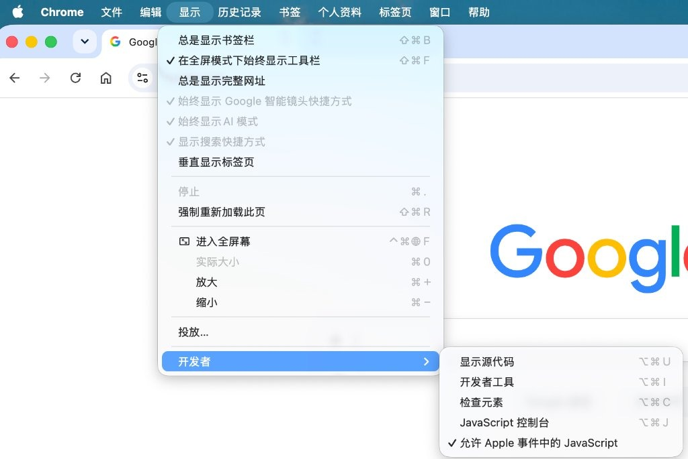

# 寻找新岗位 find-fresh-jobs 1.5.1

给你自己的 AI 助手用的本地求职列表筛选 skill。它直接在你登录好的 Google Chrome 里往下翻 Boss直聘 和智联招聘的职位列表，自动跳过看过、投过和拉黑的岗位，按关注清单高亮后整理成 Markdown 清单。

只读列表、只整理清单：**不投递、不打招呼、不打开聊天消息**。

## 谁能用（支持情况）

- **已实测可用（macOS）**：
  - **Claude Code + Claude in Chrome 扩展**：通过官方浏览器扩展读取你自己的 Chrome（扩展连接需 Claude 订阅账号，API Key 登录不支持）。
  - **Antigravity 等 macOS 本地终端 AI**：在 Chrome 菜单栏打开「允许 Apple 事件中的 JavaScript」，走 `osascript` 主世界注入脚本读取页面，不开 CDP 调试通道，Boss 不会跳空白页。
- **用 ChatGPT / Codex 能不能跑？**
  - **ChatGPT 网页版 / 普通桌面聊天窗：用不了。** 没法读写本地文件夹，跑不了 `jobscan.py` 和 `data/` 里的黑名单、看过/投过记录。
  - **Codex（有本地终端权限的 CLI / App）：在 macOS 上可以试试。**
    - 开启 Chrome「允许 Apple 事件中的 JavaScript」并放行 Apple 事件（Codex 默认沙盒可能会拦 `osascript`，需单独授权或提权），原理上能走同一套主世界注入跑通 Boss 和智联，目前尚未在 Codex 跑完过全流程。
    - 如果走自带浏览器工具 / Playwright / CDP `Runtime` 调试通道：**Boss 直聘会挂**（页面带反调试检测，一开 CDP 几秒就会变空白），这种通道下只能读智联。

## 它做什么 / 不做什么

| 做什么 | 不做什么 |
|---|---|
| 两个平台共用黑名单（支持拦整家公司、只拦单岗、或每次「不看」现问） | 不自动投递、不点「立即沟通」或「收藏」等任何发出动作 |
| 智联按「最新」翻到设定的 N 天内；自动识破凌晨刷新与置顶老岗，按本地刷新次数筛掉高频反复刷新的陈年老岗（Boss 也会按本地记录跳过 14 天内换号 ≥ 3 次且 HR/薪资未变的老岗，默认均不过滤偶发重挂） | 不打开、不读取任何招聘聊天消息 |
| 记下「看过」「投过」，同公司词序变体去重；相近标题岗位另起对比表（列出差异项），同公司同岗位重发时若换人/改薪/改要求自动放行标出差异，连续 365 天未见重现时提醒防误伤 | 不绕过验证码、不调用未公开接口、不删改你的平台求职期望 |
| 可选「关键词跳过」与「关注清单（`watch`）」——命中目标公司或关键词时在结果最前高亮置顶（其他岗位照常列出） | 除黑名单、天数、关键词外，不替你决定投不投 |
| 一次交代多件事（如「全部开始」），额度用完或断掉后说「继续」从断点接着跑 | — |

> 如需结合个人更细的作息、学历、工商、职Q口碑核查或拟招呼语，[SKILL.md](SKILL.md) 预留了可选本地规则钩子并配套了通用核查与招呼语规范（[references/](references/)），个人规则只留在你自己的目录里。

## 三步上手

### 0. 先做两件准备

- 本机装有 **Python 3.8+** 和 **Node.js 16+**。
- 在自己的 **Google Chrome** 里登录 Boss直聘、智联招聘，并**先在两个平台各自的「求职期望」里设好目标职位、城市和薪资**——本工具只沿推荐列表和求职期望列表翻页，**不按关键词搜索**，扫出的岗位是否对口取决于这里的设置。

### 1. 安装

- **直接交给 AI 助手安装**：把仓库地址 `https://github.com/mildorbit804/find-fresh-jobs` 发给你的 AI 助手（Claude Code / Antigravity / macOS 下的 Codex 等），让它克隆到 `~/.claude/skills/find-fresh-jobs` 并运行一次自检用例。
  <details>
  <summary>给 AI 助手看的安装步骤</summary>

  1. `git clone https://github.com/mildorbit804/find-fresh-jobs.git ~/.claude/skills/find-fresh-jobs`（若目录已存在，先询问使用者，不直接覆盖）。
  2. 运行 `python3 ~/.claude/skills/find-fresh-jobs/jobscan.py test`，看到「全部用例通过」再告知使用者；若缺少 Python 或 Node.js，提示使用者自行安装，不代装。
  3. 提醒使用者**新开一个对话**（当前对话通常还没重新加载新装好的 skill），说「介绍一下」开始配置。

  </details>
- **手动安装**：
  ```bash
  git clone https://github.com/mildorbit804/find-fresh-jobs.git ~/.claude/skills/find-fresh-jobs
  python3 ~/.claude/skills/find-fresh-jobs/jobscan.py test
  ```
  不用 git 的话，在 GitHub 页面点 **Code → Download ZIP**，解压后把文件夹改名为 `find-fresh-jobs` 放进 `~/.claude/skills/`，再运行上面的 `jobscan.py test`。

### 2. 打通你的 Chrome

- **用 Claude Code**：
  1. 在 Chrome 商店安装 [Claude in Chrome 扩展](https://chromewebstore.google.com/detail/claude/fcoeoabgfenejglbffodgkkbkcdhcgfn)（1.0.36+）。
  2. 用与 Claude Code **相同的 Claude 账号**登录；账号下有多个组织的，两边须选**同一个组织**。
  3. 终端运行 `claude --chrome`，或在 Claude Code 里输入 `/chrome` 设为默认启用（显示 `Status: Enabled`、`Extension: Installed` 即连好）。
- **用 Antigravity 等 macOS 本地终端 AI（或尝试 Codex）**：
  - 在 Chrome 顶部菜单勾选：**显示 → 开发者 → 允许 Apple 事件中的 JavaScript**（英文界面为 `View → Developer → Allow JavaScript from Apple Events`），并确保在这个 Chrome 里已经登录 Boss直聘、智联招聘：

  

### 3. 直接开口扫

新开一个对话，先说「介绍一下」。第一次使用会一次性问你偏好（看几天 / Boss 复核时 HR 活跃度门槛、黑名单怎么拦、不想看的词、两边扫先扫谁、碰验证先跳过还是停下），以后只在你要求时改。建议首次先试跑一个标签（例如「扫一下 Boss 推荐」），跑通后再全扫。

常用口令：

- **开始扫描**：「扫一下 Boss 推荐」「扫一下智联的〈期望标签名〉」「开始 Boss」「开始智联」「全部开始」
- **查找已扫结果**：「帮我找刚才清单里 X 公司的文员、Y 公司的助理」「看看以前保存的清单里有没有数据分析」（只查本地已存结果，不搜全站）
- **关注清单（长期盯梢置顶）**：「帮我盯一下 XX 公司」「岗位或描述带英语的留意下」「看看关注清单」「关注第 2 条不用盯了」（命中只置顶提醒，别的岗位照常看）
- **拉黑与记已投**：「第 3 个不看」「这家公司拉黑」「A品牌和B有限公司是同一家」「第 3 个投了」
- **调整规则**：「改成只看 3 天内的」「Boss 改成只看 3 日内活跃」「Boss 不按 HR 活跃度筛」「Boss 两处没写明双休直接排除」「改成 2 周内刷新超过 4 次再跳过」「看过的 180 天后重现再放出来」「凌晨刷新的改按首次发布算」「行政标签下不看推广」「预览一下销售会拦哪些」「清空看过的记录」
- **核查与招呼语**：「按六项核查深查第 1 条」「看看可选核查经验」「给合格岗位配招呼语」
- **中断控制**：「继续」「继续扫描」「登录好了」「停一下」

## 输出示例

每次扫完先给一行统计，命中关注清单单独置顶高亮，再列新岗位清单与跳过明细，完整结果同步保存在 `data/results/` 下的 Markdown 文件里：

```text
智联招聘 · 示例标签：翻到「超过7天」，共读 320 条，留下 3 条。黑名单跳过 2 条，超过 7 天跳过 300 条，关键词跳过 5 条，投过的跳过 1 条，看过的跳过 8 条，重复的丢掉 1 条
```

**特别留意命中（关注清单 `watch`）**

| 原序号 | 命中关注 | 公司 | 岗位 | 薪资 | 发布时间 | 链接 |
|---|---|---|---|---|---|---|
| 1 | 目标公司：示例公司 A | 示例公司 A | 运营专员 | 6000-8000元 | 2030-01-09 10:12:00 | [打开](https://example.com/job/1) |

**新岗位清单**

| # | 公司 | 岗位 | 地点 | 薪资 | 发布时间 | 链接 |
|---|---|---|---|---|---|---|
| 1 | 示例公司 A | 运营专员 | 示例区·示例路 | 6000-8000元 | 2030-01-09 10:12:00 | [打开](https://example.com/job/1) |
| 2 | 示例公司 B | 数据助理 | 示例区·示例街 | 5000-7000元 | 2030-01-08 09:30:00（凌晨自动刷新，按首次发布） | [打开](https://example.com/job/2) |
| 3 | 示例公司 C | 项目助理（有相近的，见下表） | 示例新区 | 7000-9000元 | 2030-01-06 15:45:00 | [打开](https://example.com/job/3) |

后面还会附上**黑名单拦下**、**投过/重复跳过**以及**同公司相近标题对比表**（比如 `项目助理` vs 已看过的 `高级项目助理`，只列出薪资/经验/学历等列表可见项的异同，方便你顺手复核有没有误拦或错合并）。

## 注意事项与常见问题

- **账号与协议风险**：自动翻页可能触发平台安全验证、限制功能，甚至违背平台用户协议，请自行阅读条款并判断是否使用。本工具不破解验证码、不抓取后端接口、不批量采集转卖；碰到滑块或掉线立刻停下等你自己处理。
- **数据与隐私**：配置、黑名单、关注清单、看过/投过记录和结果保存在本机 `data/`（不会提交进仓库）；但对话记录和读到的岗位列表内容，仍会按你所用 AI 服务的规则经过云端处理。
- **翻页要求**：每屏停 3–6 秒、不点开详情卡片；扫描时请把正在扫的标签页留在前台，切到后台 Chrome 会给页面降速。
- **Boss 为什么不按天数筛？** Boss直聘网页的列表和详情都不公开岗位发布日期，因此发布时间列固定写「不显示」（列表会顺带标出此刻是否「HR当前在线」），每个标签翻到底，靠「看过」记录只列你没看过的；进入少数候选详情页复核时，默认改按 **HR 活跃度 1 周内**排除「2 周内活跃」「本月活跃」及更早的岗位（可在配置中调整或关闭）。
- **地点为什么只到区？** 列表里只有区和商圈/街道，工具不逐个点开岗位页，具体门牌点链接自己看。
- **公司全称与简称不同怎么拉黑？** 规则会自动去掉开头的省市区前缀、结尾的「有限公司」以及过长省略号；如果品牌名和工商登记名完全对不上，把两个名字各拉黑一条即可。

**扫出来的岗位不对口怎么办？**
先回 Boss直聘、智联招聘检查「求职期望」（目标职位、城市、薪资），工具不按关键词搜索，只按平台给出的列表往下翻；再用「不想看的关键词」滤掉不相关标题。

**额度用完或对话中断怎么办？**
新对话说「继续」或「继续扫描」即可。`data/progress.json` 记着上次的任务顺序和完成进度，会从没做完的那一件接着扫，已列给你看过的不会重列。

**Claude 提示浏览器扩展没连上怎么办？**
依次检查：Chrome 是否开着；`chrome://extensions` 里 Claude 扩展是否开启；扩展和终端 Claude Code 是否登录同一个账号、同一个组织。可在终端输入 `/chrome` 选 `Reconnect extension`，或两边都退出重启。

## 文件结构

| 文件 | 作用 |
|---|---|
| `SKILL.md` | 给 AI 助手执行的完整操作规程 |
| `references/` | 六项核查与上下文防误判、可选核查经验包（默认关闭）、招呼语规范与问答边界 |
| `jobscan.py` | 配置、黑名单、别名、关注清单、关键词、投过/看过、查找与页面注入生成器 |
| `page/common.js` | 双平台共用的页面脚本逻辑（黑名单/别名比对、天数、翻页、输出） |
| `page/boss.js`、`page/zhilian.js` | Boss直聘、智联招聘各自列表解析与翻页逻辑 |
| `tests/` | 单测与文档/改错核对用例（每次运行 `jobscan.py` 自动先检，不通过不执行） |
| `docs/` | Chrome 授权示例截图与仓库预览图 |
| `CHANGELOG.md` | 版本更新记录 |
| `data/` | 本地状态、自动备份与扫描结果目录（自动生成，git 忽略） |

问题反馈与建议请走 [Issues](https://github.com/mildorbit804/find-fresh-jobs/issues) 或 [Discussions](https://github.com/mildorbit804/find-fresh-jobs/discussions)。协议：[MIT](LICENSE)。
